<h1 align="center">wss-openrouter</h1>

<p align="center">
  <strong>What people actually ask AI models to do, captured weekly</strong>
</p>

<div align="center">

  <a href="https://github.com/q3dresearch/wss-openrouter/actions/workflows/capture-weekly.yml"></a>
  <a href="https://github.com/q3dresearch/wss-openrouter/commits"></a>
  <a href="https://github.com/q3dresearch/wss-openrouter/blob/main/LICENSE"></a>
  <a href="https://github.com/q3dresearch/wss-openrouter"></a>

</div>

<p align="center">
  <sub>fleet: <a href="https://github.com/q3dresearch/wss-engine">engine</a> · <a href="https://github.com/q3dresearch/wss-hugging-face">hugging face</a> · <strong>openrouter</strong> · <a href="https://github.com/q3dresearch/wss-cloud-footprint">cloud footprint</a> · <a href="https://github.com/q3dresearch/wss-mining-pipeline">mining</a> · <a href="https://github.com/q3dresearch/wss-forest-harvest">forest</a> · <a href="https://github.com/q3dresearch/wss-food-trace">food</a></sub>
</p>

The task mix, session economics, provider directory and benchmark scores here
all come from endpoints with no date parameters: they describe *now*, and last
month's version is already unrecoverable. Model rankings are the exception, and
this repo deliberately does not capture them — see Contributing.

OpenCode's own telemetry is the second client-side view: which models coding
agents actually run, with session cost, cache ratio, retention and geography.
Its page recomputes hourly and keeps a rolling 56-day daily window, so the
weekly capture is the only copy of a day once it rolls off. Session cost and
list prices add a second platform to Q5 and Q6; the daily model series makes
displacement (Q3) visible without waiting for a workload split. Coverage
begins with the first capture, on 2026-10-26.

The provider directory is a different kind of source: a current roster of who
serves inference, with headquarters and named datacenters. Most providers name
no datacenter, which is the finding rather than a capture gap — see Caveats.

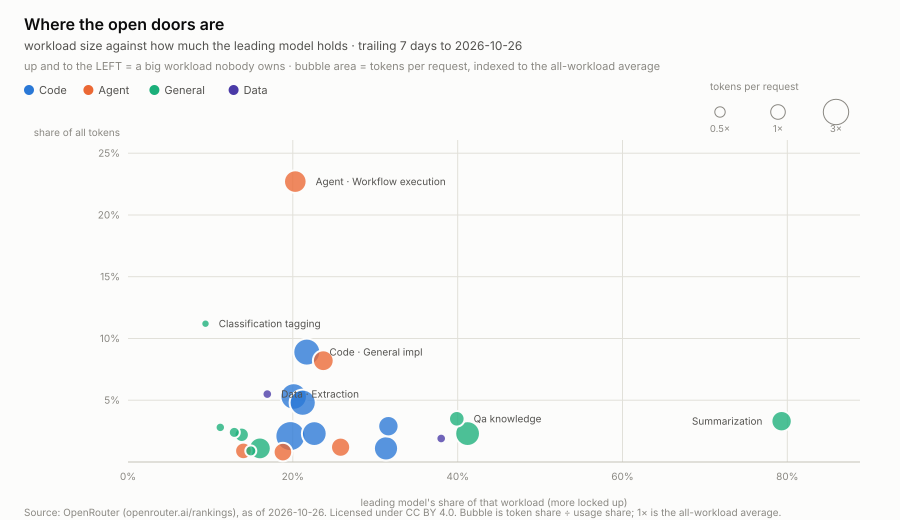

**The biggest workload is still the one nobody owns.** Agentic workflow
execution is 22.3% of all tokens and its leading model holds 19.1% of it — no
majority. Summarization is the exception: 3.4% of tokens, 70.8% held by one
model. Code workloads are fragmented: general implementation, debugging, file
I/O and review all have leaders in the 17–20% range. Bubble area is **tokens per
request**, indexed to the all-workload average (token share ÷ usage share), so
the large bubbles are long-request workloads, not necessarily big ones.

**Every source, its live URL, its licence and its last stored capture is listed in [SOURCES.md](SOURCES.md)** — generated by `wss sources`, so it cannot drift from the registry.

## Questions this exists to answer

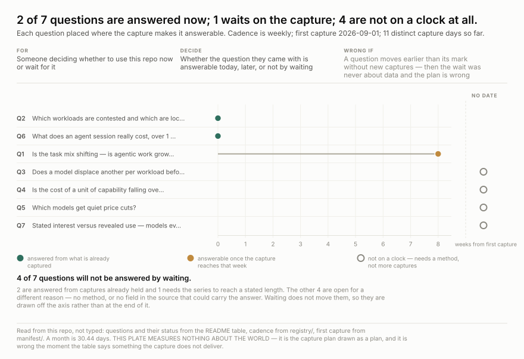

**2 of these 7 are answered from captures already held.** 1 becomes answerable only as the series lengthens — the plate shows when. The remaining 4 are not on a clock: they need a method, or a field this source does not publish, and waiting produces neither. That distinction is the one a reader cannot make from a table of open questions.

A source that answers no question gets dropped. A question nothing answers is
the next thing to build. Append freely.

| # | Question | Status |
| --- | --- | --- |
| Q1 | Is the task mix shifting — is agentic work growing, and at whose expense? | needs ~8 weeks |
| Q2 | Which workloads are contested and which are locked up? | answered — chart above |
| Q3 | Does a model displace another per workload before it shows in aggregate rankings? | accruing |
| Q4 | Is the cost of a unit of capability falling over time? | accruing |
| Q5 | Which models get quiet price cuts? | accruing |
| Q6 | What does an agent session really cost, over 1 turn versus 50? | answered — chart below |
| Q7 | Stated interest versus revealed use — models everyone downloads but nobody serves. | open — research join below (24% of tokens) |

## What you can build

Charts come from [examples/visualize.py](examples/visualize.py) — stdlib only,
deterministic, no network.

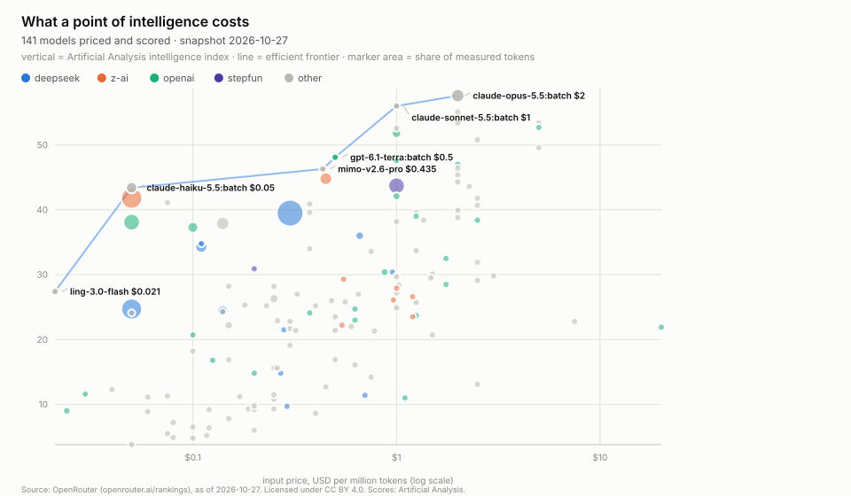

**Q4 — the efficient frontier**, where nothing is both cheaper *and* smarter:
`ling-3.0-flash` (index 27.4 at $0.021/Mtok) up to `claude-opus-5.5:batch`
(57.6 at $2.00). Marker area is share of measured tokens, so you can see which
good-value models people actually run. Everything far below the line is priced
like a flagship and scoring mid-tier.

### What an agent session costs

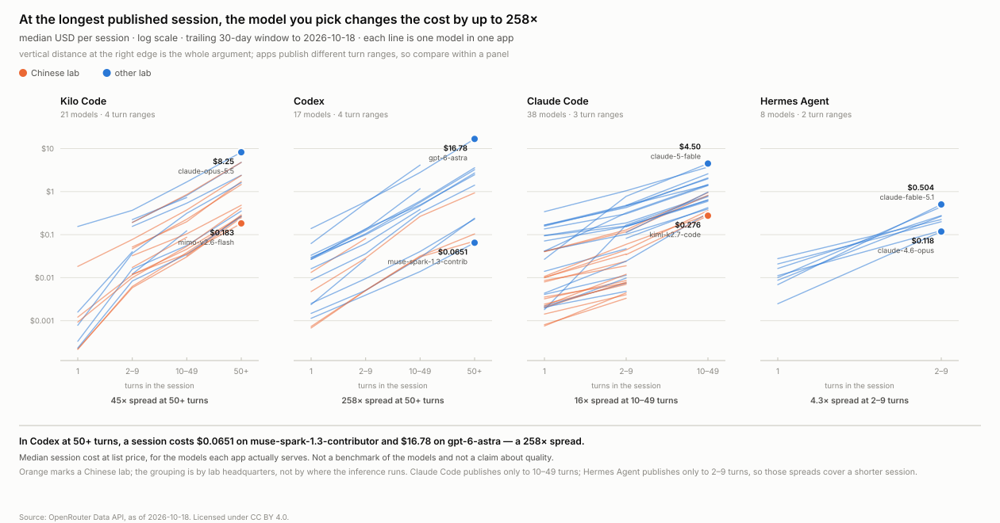

**Q6 — the spread list prices cannot show.** At the longest published session,
Codex runs from **$0.065** on `muse-spark-1.3-contributor` to **$16.78** on
`gpt-6-astra` — a **258×** difference for one session. Kilo Code spans 45× at
50+ turns and Claude Code 16× at 10–49. Apps publish different turn ranges, so
compare within a panel, not across: Claude Code stops at 10–49 turns and Hermes
Agent at 2–9. These are median list-price costs for the models each app serves,
not a benchmark of model quality. Orange marks a Chinese lab.

<details>
<summary>Two more views: token composition, and who leads each workload</summary>

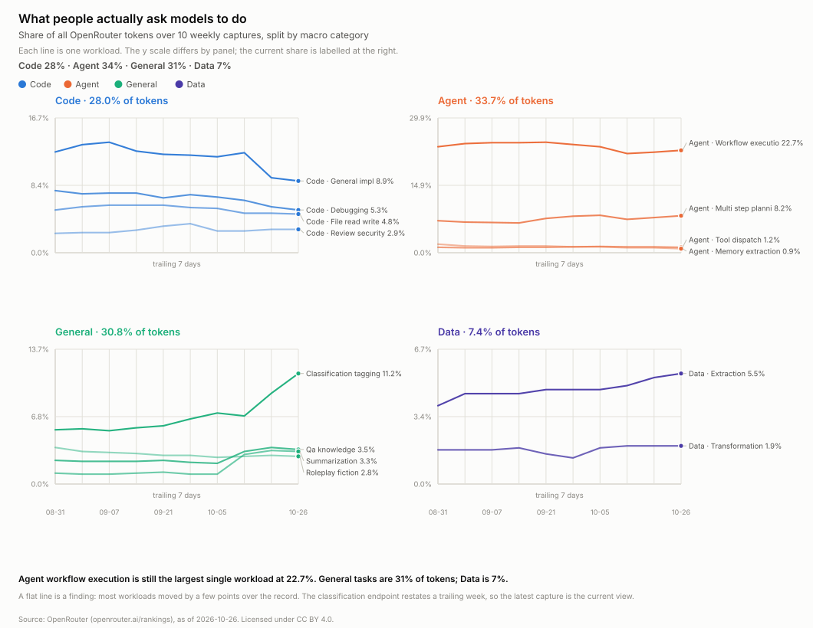

**The task mix is a small-multiple trend, not a ranking.** Each panel is one of
OpenRouter's macro categories — code, agent, general, data — and each line is a
workload's share of all tokens over the nine weekly captures. The mix is
remarkably flat at this scale: agentic workflow execution is still 22.3% and
the four macro shares moved by only a few points.

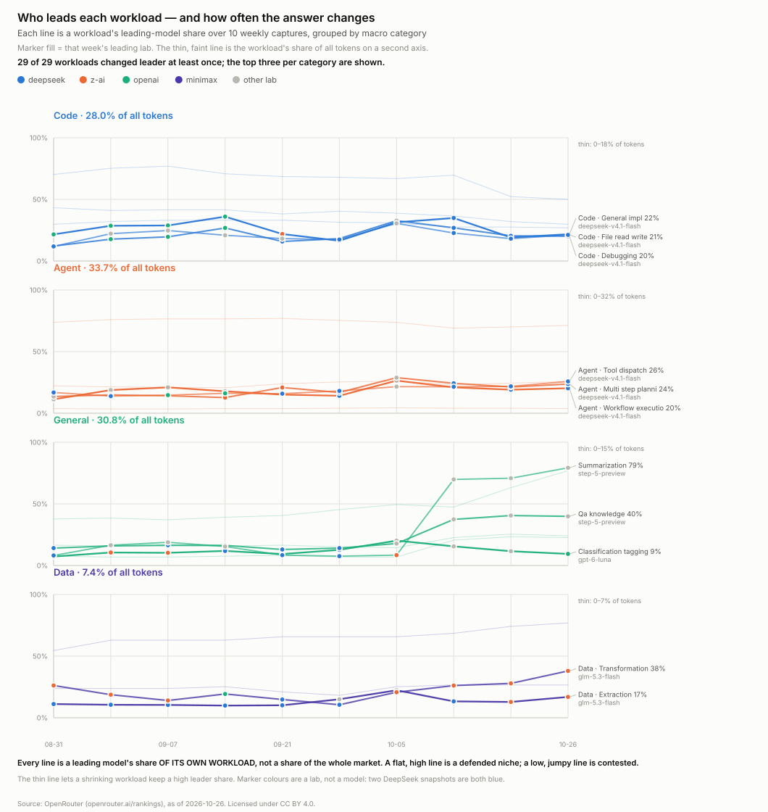

**Leadership turns over even when the mix does not.** Every workload changed
its leading model at least once in nine weeks. Marker fill is the leading lab,
so a colour change is a change of leader; the thin faint line is the workload's
share of all tokens on a second axis. OpenRouter's published macro categories
are code, agent, general and data; `classification_tagging` and
`conversational_reply` are workloads inside general, not top-level categories.

</details>

Cross-source joins use `canonical_slug` — the dated permaslug the benchmark
endpoints key on, not the catalogue's undated `id`. That difference is 156
matches versus 23.

## The longer view: two research windows

The weekly capture is the point-in-time record. These figures ask the same
questions over two different windows: OpenRouter's own archive back to
2025-01, and OpenCode's rolling 56-day window. They are built by
[`examples/research/run.py`](examples/research/run.py), with the method and
caveats in [`examples/research/README.md`](examples/research/README.md). The
publisher archives and OpenCode's historical snapshots are fetched on demand
and cached under `examples/research/work/`; that cache is gitignored and never
committed.

### OpenRouter: 21 months of routed traffic

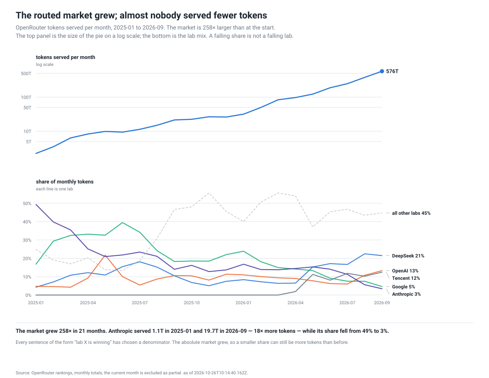

**The pie grew faster than any slice.** OpenRouter served **258×** more tokens
in September 2026 than in January 2025. Every top-five lab served more tokens
at the end: Anthropic went from **1.1T to 19.7T** (18×) while its share fell
from **49% to 3%**; DeepSeek went from **0.1T to 123.7T** (1,298×) and from
**4.3% to 21.5%**. A share chart is not a survival chart.

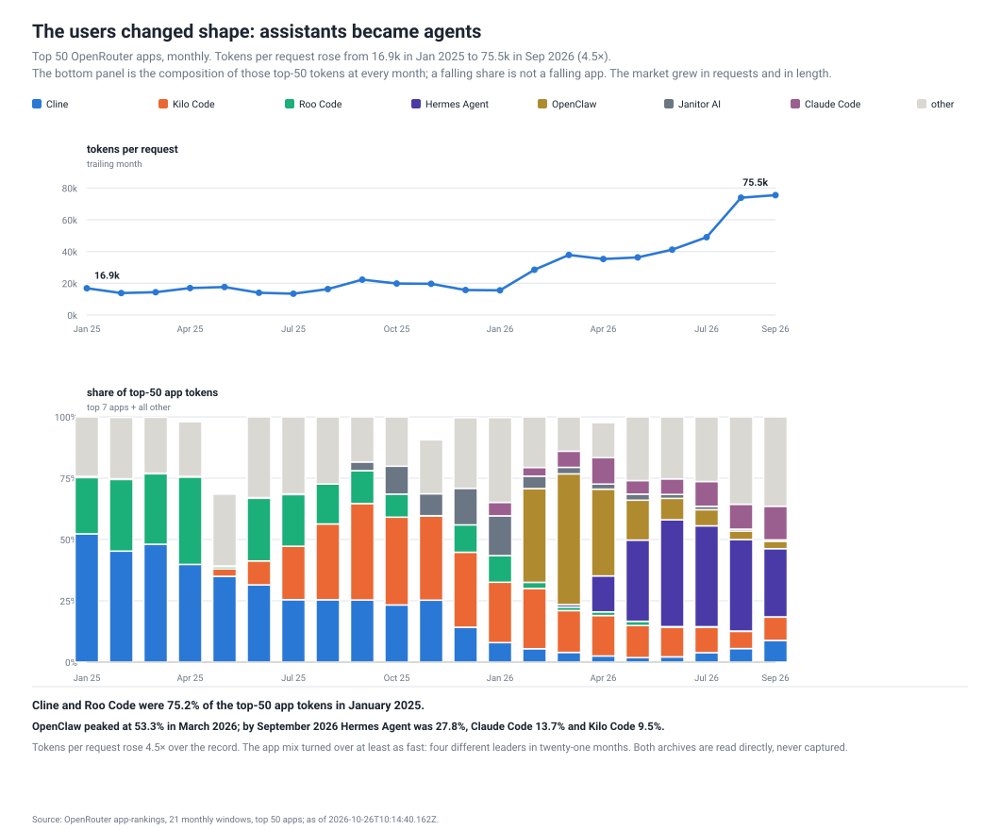

**The users changed shape.** The chart now uses **21 monthly app windows**, not
two endpoints. In January 2025, Cline and Roo Code were **75.2%** of the top-50
app tokens and a request averaged **16.9k** tokens. OpenClaw peaked at **53.3%**
in March 2026; by September 2026 Hermes Agent was **27.8%**, Claude Code
**13.7%** and Kilo Code **9.5%**, and a request averaged **75.5k** tokens — a
**4.5×** rise. The market grew in requests *and* in length per request, while
four different apps held the top spot. (Shares are within the top 50, not a
platform census.)

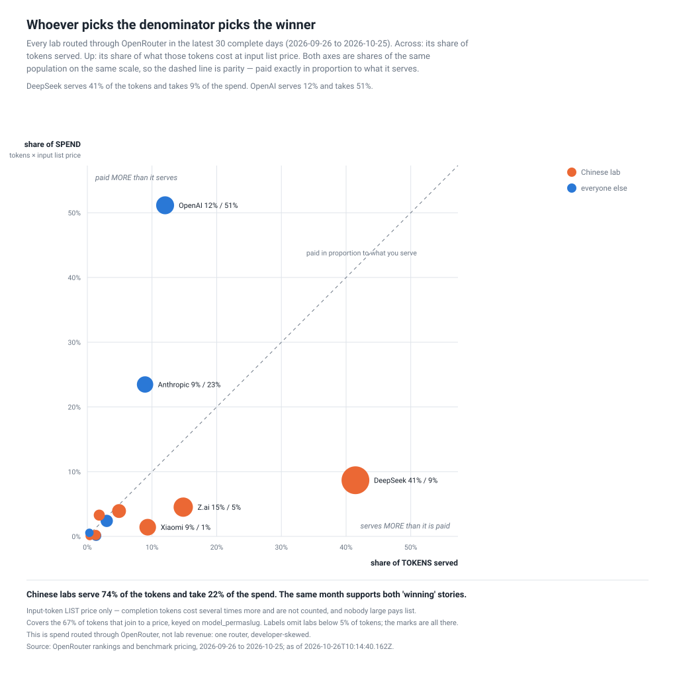

**Tokens are not money.** Of the **67%** of tokens that join to an input list
price in the latest 30 complete days, DeepSeek serves **41%** and takes **9%**
of priced spend; OpenAI serves **12%** and takes **51%**, and Anthropic **9%**
and **23%**. This is input list price, not billed revenue.

<details>
<summary>Capability, downloads and shelf life</summary>

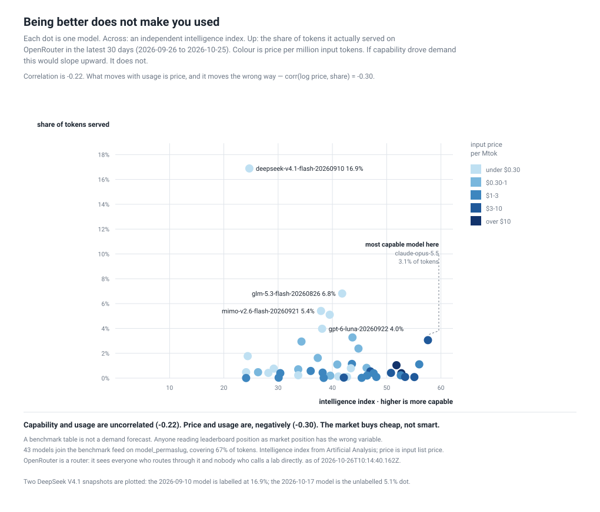

**Capability did not predict usage** across 43 models with both a benchmark
score and a measured share: r = **−0.22**. Price did not rescue the story
either (r = **−0.30** on log price). The independent benchmark is not a demand
forecast.

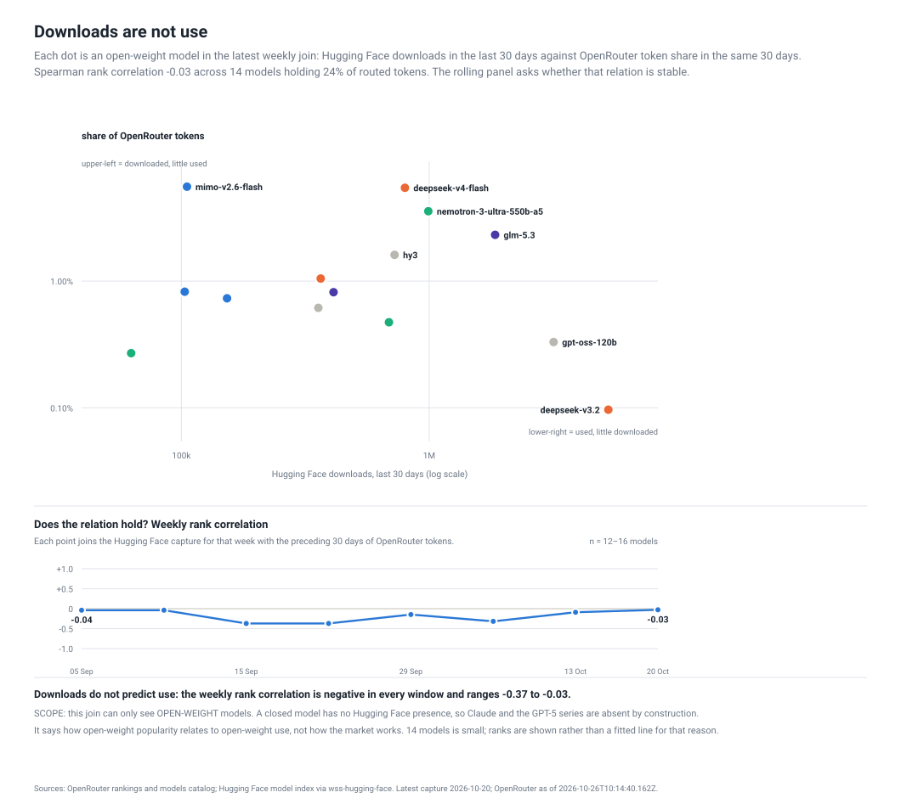

**Downloads did not predict use** for the 14 open-weight models that join to
Hugging Face downloads (Spearman **−0.03**). The join covers **24%** of tokens;
closed models have no downloads to join. The lower panel rolls the same join
across eight weekly Hugging Face captures: the rank correlation is negative in
every window, between **−0.37** and **−0.03**. The relation is consistently
weak, not just a one-week accident.

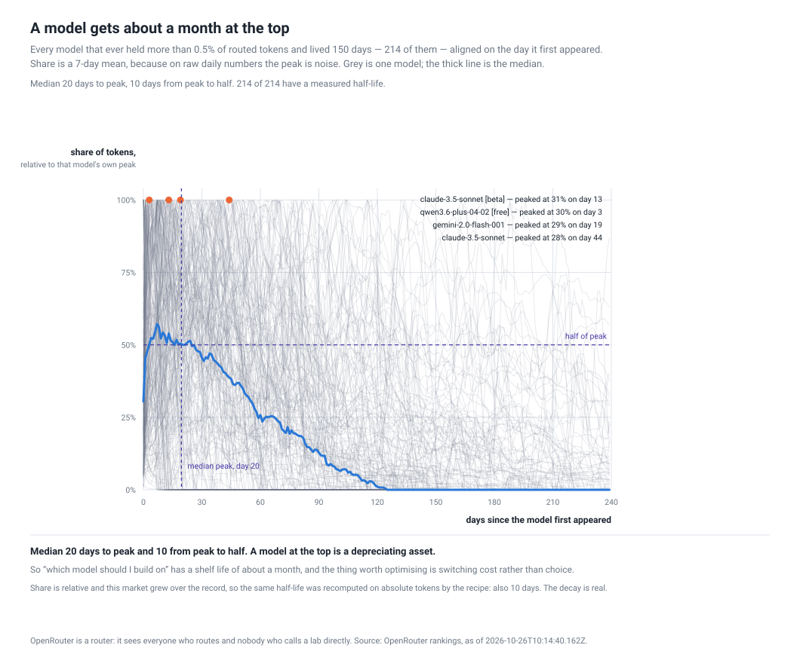

**A model gets about a month at the top.** The median model peaks **20 days**
after its first appearance and falls to half its peak share **10 days** later.
The 7-day mean is a share in a growing market, so the absolute tokens can rise
while the line falls.

</details>

### OpenCode: the coding-client window

OpenCode is the client-side view: one coding agent, a rolling 56-day daily
series, and no archive beyond it. The weekly capture is what keeps the days.
The chart drops the current UTC day because the page recomputes hourly and the
last row is partial.

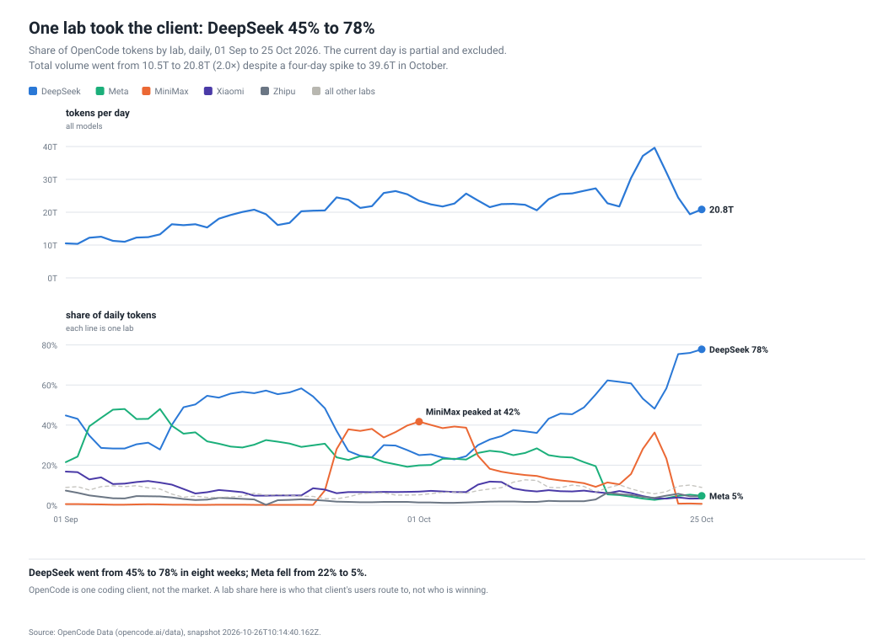

**One lab took the client.** DeepSeek's share of OpenCode tokens rose from
**44.8%** on 2026-09-01 to **77.8%** on 2026-10-25. Meta fell from **21.5% to
4.7%**, Xiaomi from **16.8% to 3.4%**, and Zhipu from **7.3% to 4.5%**. MiniMax
spiked to **41.7%** on 2026-10-01, then fell back to **0.7%** at the end; the
spike is a displacement event, not a stable position. Total tokens rose from
**10.5T to 20.8T** over the window, with a four-day peak at **39.6T** on
2026-10-21.

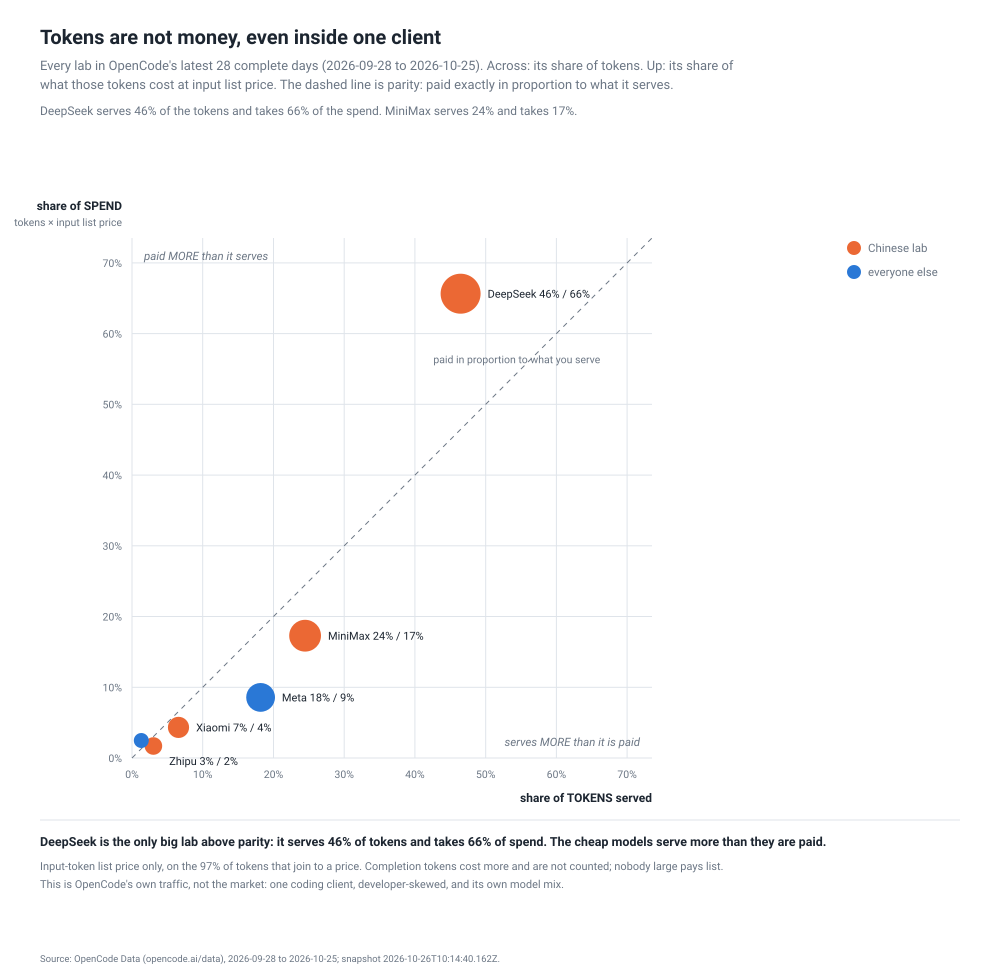

**The same split appears inside one client.** Over the latest 28 complete
days, DeepSeek is **46%** of priced tokens and **66%** of input-price spend;
MiniMax is **24%** and **17%**; Meta is **18%** and **9%**. The price join
covers **97%** of tokens. This is input list price, not OpenCode's published
session cost.

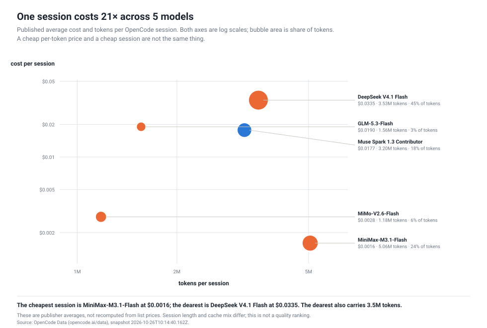

**A cheap token and a cheap session are different products.** OpenCode's
published average session ranges from **$0.0016** on MiniMax-M3.1-Flash
(5.06M tokens) to **$0.0335** on DeepSeek V4.1 Flash (3.53M tokens) — **21×**.
GLM-5.3-Flash is $0.0190 at 1.56M; Muse Spark is $0.0177 at 3.20M; MiMo-V2.6
is $0.0028 at 1.18M. These are publisher averages, not recomputed from list
prices.

<details>
<summary>Displacement, retention and geography</summary>

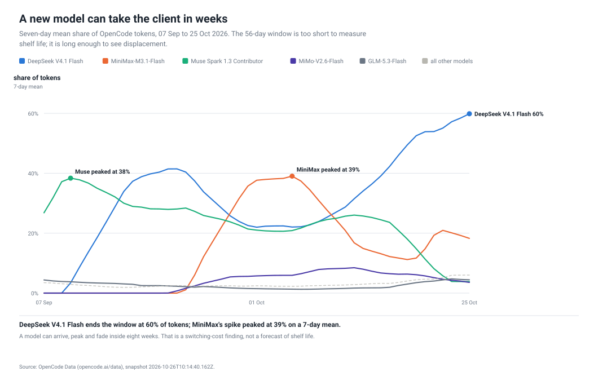

**Displacement is fast and not permanent.** In the latest seven complete days,
DeepSeek V4.1 Flash is **59.9%** of tokens, MiniMax-M3.1-Flash **18.3%**,
GLM-5.3-Flash **4.4%**, Muse Spark **3.8%** and MiMo-V2.6 **3.6%**. The
seven-day mean shows the direction; the 56-day window is too short for a
shelf-life estimate.

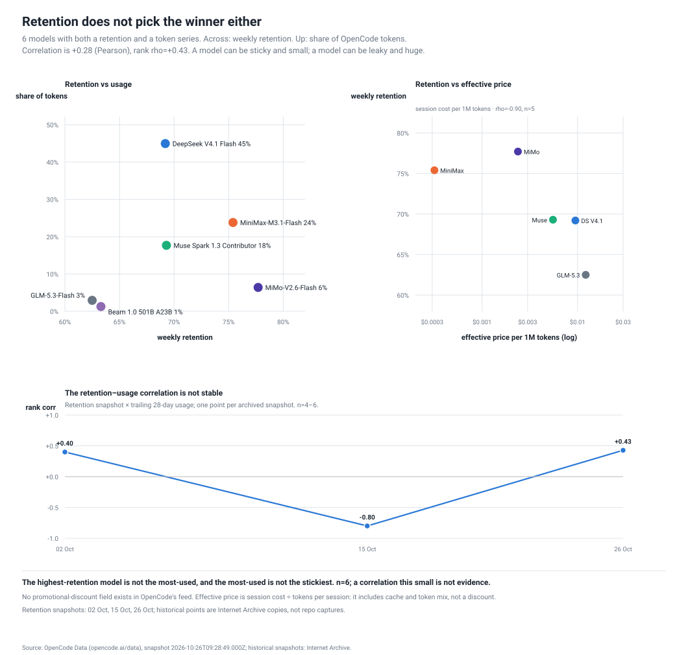

**Retention and usage are only weakly related** across six models with both
measures: r = **+0.28**, rank rho **+0.43**. MiMo has the highest retention
(**77.7%**) and a small token share; DeepSeek has the largest share and
**69.2%** retention. The rank correlation moves **+0.40 → −0.80 → +0.43** across
the three available retention snapshots (n=4–6), so even the sign is not stable.

**Discounts are not observable in this feed.** OpenCode publishes list prices
and average session cost, not a promotional-discount series. Using session cost
per 1M tokens as an effective price, retention ranks **−0.90** across five
models: cheaper effective tokens are stickier. That is a cross-section, not a
discount effect, and five points are not evidence of causation.

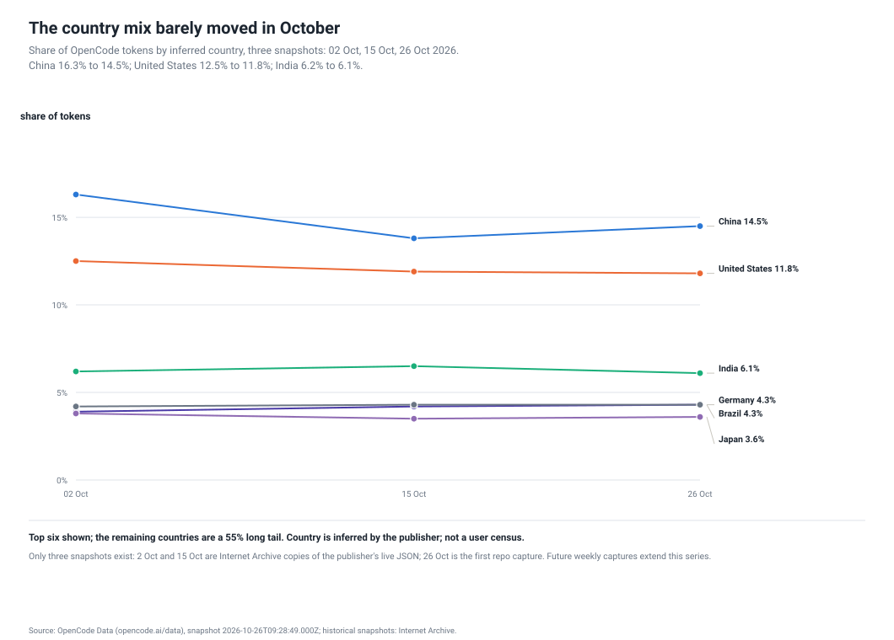

**The country mix barely moved** across the three available snapshots: China
**16.3% → 14.5%**, the US **12.5% → 11.8%**, India **6.2% → 6.1%**. No country
is above 15% in the latest view, and the top ten are **55%** of tokens. The
publisher infers country; this is not a user census. Only 2 Oct and 15 Oct are
archived copies; 26 Oct is the first repo capture, so weekly captures will
extend the series.

</details>

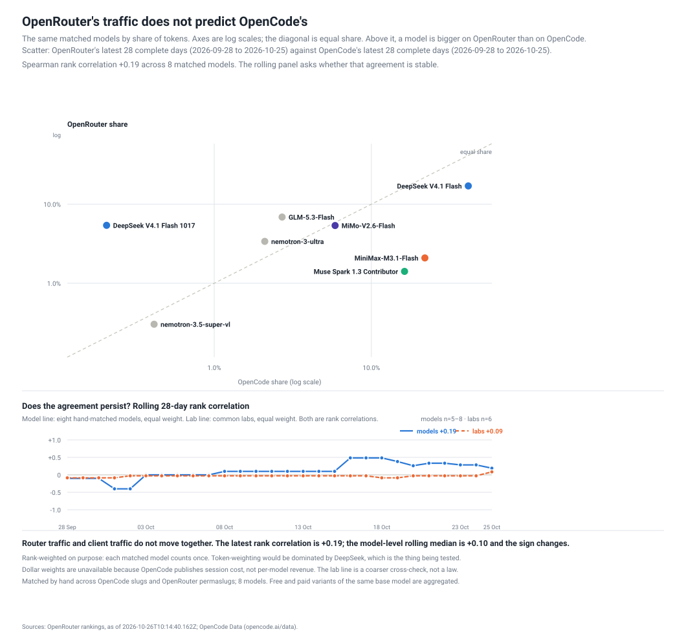

**Router traffic is not client traffic.** The scatter uses the latest **28
complete days** on both sides. DeepSeek V4.1 Flash is **17.0%** of OpenRouter
tokens and **45.0%** of OpenCode's; MiniMax-M3.1-Flash is **2.1%** and
**23.8%**; Muse Spark is **1.4%** and **17.7%**. The 28-day rolling rank
correlation is **+0.19** at the end and has a median of **+0.10**, with the
sign changing across the window. The lab-level line tells the same story. The
method is rank-weighted: every matched model counts once, because token
weights would be dominated by DeepSeek; dollar weights are unavailable since
OpenCode publishes session cost, not per-model revenue. Different populations,
different windows, and a hand-checked model mapping: use either as a view, not
as a demand forecast.

The companion recipe,
[`openrouter-lab-share`](https://github.com/q3dresearch/cookbook/tree/main/recipes/openrouter-lab-share),
is the method source for the OpenRouter figures. This repo applies the same
question set to OpenCode's shorter window rather than re-archiving either
publisher.

## Using it

**Reading this data needs nothing** — no key, no account, no clone. The API
key below is only for running your own capture:

```bash
B=https://raw.githubusercontent.com/q3dresearch/wss-openrouter/main/derived/observations
duckdb -c "SELECT * FROM read_csv_auto('$B/2026-09.csv') LIMIT 5"
```

```bash
head derived/observations/*.csv          # one row per entity/metric/day
python examples/load_observations.py     # sqlite + example queries
python examples/visualize.py             # regenerate the weekly charts
python examples/chart-maturity.py        # regenerate the maturity plate
python examples/research/run.py          # regenerate the archive-backed figures
```

The weekly `derive` workflow reruns `examples/visualize.py` before
`wss datapage`; the monthly `research` workflow refreshes the archive-backed
figures. Both commit only generated output, so the page and the figures move
with the data.

Columns are `series_id, entity_id, observed_at, captured_at, metric, value,
unit, source_id, raw_ref, parser_version`. `entity_id` is namespaced so
sources join on it: `task:agent:workflow_execution`,
`task:<tag>/model:<id>`, `app:claude-code/turns:50-plus-turns/model:<slug>`,
`model:<slug>`, `lab:<slug>`, `country:<ISO>`, `provider:<slug>`,
`provider:<slug>/datacenter:<code>`, or a bare model permaslug.
OpenCode's `model:` slugs are its own (`model:deepseek-v4.1-flash`), not
OpenRouter permaslugs (`deepseek/deepseek-v4.1-flash`), so match through the
catalogue rather than assuming the strings join. `model_name` and `model_lab`
are carried on those entities as `ref` observations to make the match explicit.

**One gotcha.** Several sources restate the same `observed_at` on every
capture — the task mix describes a trailing week, so three captures produce
three rows for it. That is deliberate: it is how a *revision* becomes visible.
But it means naive filters double-count, so deduplicate on
`(series_id, entity_id, metric, observed_at)` taking the latest `captured_at`.
Every query in [examples/queries.sql](examples/queries.sql) shows the pattern.

Eight weekly sources — OpenRouter's task classifications, three benchmark
sets, session costs, model catalogue and provider directory, plus OpenCode's
usage telemetry — captured Mondays 22:35 UTC by the
[wss](https://github.com/q3dresearch/wss-engine) engine. Coverage dates live in
[health/health.csv](health/health.csv).

## Contributing

**The test for a new source: which open question does it close?** If the
answer is "none", it does not go in.

That rule is why `rankings-daily` is absent. OpenRouter archives per-model
token volumes back to 2025-01-01 in windows up to 366 days, so capturing them
would rebuild an archive that already exists — and `wss validate` rejects such
a source outright (`destroys_own_history: false`). Query it directly when you
need it, citing their `meta.as_of`. An earlier version of this repo scraped an
undocumented endpoint for the same numbers; it has been removed.
`datasets/app-rankings` is the same case: it accepts arbitrary historical
windows (2025-02 and 2026-08 both return data), so it is queried, not captured.

`opencode.data.usage` is the opposite case: the publisher keeps only a rolling
56-day window and recomputes hourly, so the weekly capture is the archive.
Its snapshot sections are dated by `updatedAt`; the daily sections carry their
own dates. Both are preserved in `observed_at`, not flattened to fetch time.

`openrouter.providers.directory` is the third case: a current snapshot with no
date parameter and no archive, so a provider moving headquarters or naming a
datacenter is gone next week. It closes a question the table does not number:
whether a provider says where inference runs at all. The field is mostly empty,
and that emptiness is the finding.

### Running your own capture

OpenRouter's Data API is gated by **the same key that authorises paid
inference on your account** — treat it as a payment credential, not a read
token. Create a dedicated key at
[openrouter.ai/settings/keys](https://openrouter.ai/settings/keys), set a
spend limit, then:

```bash
cp .env.example .env.local
$EDITOR .env.local     # OPENROUTER_API_KEY and WSS_CONTACT
chmod 600 .env.local   # gitignored; verify with: git check-ignore -v .env.local
```

For CI, add both as repository secrets. The registry holds only the variable's
*name* (`auth: {bearer_env: OPENROUTER_API_KEY}`); the engine sends it as a
header, and it never reaches `raw/`, the manifest or any log. Rate limits are
30/minute and 500/day — ample for the six authenticated OpenRouter sources.
The provider directory and OpenCode need no key at all.

## Caveats

- **Classifications are sampled** and published as shares only. No absolute
  volumes; composition is the question this answers.
- **OpenRouter is not the market** — one router, developer-skewed, with its
  own model mix. A proxy for production usage, not a census.
- **OpenCode is one client, not the market.** Users and sessions are
  approximate distinct counts; costs are average per OpenCode session at list
  prices, not billed revenue. Its daily window rolls after 56 days, so
  coverage before the first capture does not exist.
- **Provider metadata is a current snapshot and mostly blank on data
  residency.** In a 2026-10-26 check of the live directory, 84 of 114
  providers named no datacenter and 36 named no headquarters. The data-residency
  question is answerable for the minority that publish a location, not for the
  field.
- **Benchmark scores are third-party.** Artificial Analysis and Design Arena
  set their own methodologies; cite the originator.

## Licences

Code MIT. Data is CC BY 4.0 for **five of eight sources** — see
[LICENSE-DATA](LICENSE-DATA). `openrouter.models.catalog` and
`openrouter.providers.directory` declare only the platform terms and are
**not** covered by the grant; `opencode.data.usage` states no explicit licence
and is **not** covered either. Rows carry `source_id`, so which applies is
determinable from the data.

OpenRouter's CC BY 4.0 rankings sources require this citation when
republishing figures:

> Source: OpenRouter (openrouter.ai/rankings), as of &lt;meta.as_of&gt;.
> Licensed under CC BY 4.0.

The session-cost dataset declares its own citation:

> Source: OpenRouter Data API, as of &lt;as_of&gt;.

The `as_of` value is preserved as `observed_at` on every row, so the citation
reconstructs from the data itself.

OpenCode asks for a citation but grants no licence:

> Cite OpenCode Data (opencode.ai/data) with the update time shown at the top
> of the page.

The page's update time is preserved as `observed_at` on the snapshot rows, so
that citation reconstructs too.

Topics: `git-scraping` · `open-data` · `point-in-time-data` · `dataset`
